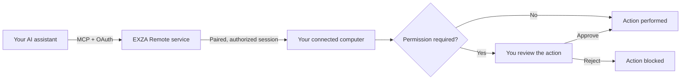

# EXZA Remote

### Your computer. Your control. With ChatGPT and Claude.

**An MCP server for AI-powered remote computer access: connect ChatGPT, Claude, and other compatible AI assistants to your own Mac, Windows, or Linux computer with secure device pairing and owner-controlled permissions.**

[**Visit Website**](https://remote.exza.de/) · [**Get Started**](https://remote.exza.de/app/) · [**Documentation**](https://remote.exza.de/help) · [**Explore Prompt Library**](https://remote.exza.de/prompts/)

[Deutsch](README.de.md) · [Security](SECURITY.md) · [Support](https://remote.exza.de/help)

---

## AI remote computer access with MCP — without giving up control

EXZA Remote helps developers, creators, and technical teams connect **ChatGPT or Claude to their own computer** through the **Model Context Protocol (MCP)**. It is a remotely accessible MCP service with a local computer client, not a cloud-hosted virtual desktop or a generic code repository.

**Why use it?** You can ask an authorized AI assistant to inspect supported files, check a system, follow a terminal job, or handle compatible desktop tasks — while keeping permissions, device pairing, and sensitive-action approvals under your control. Available capabilities depend on your operating system, AI client, and authorized scope.

| For | Example benefit |
| --- | --- |
| **Software developers** | Review permitted project files and run an approved local test without pasting every terminal result into chat. |
| **IT and technical support** | Inspect device status and allowed diagnostic output from a paired computer. |
| **3D creators and makers** | Use supported desktop and terminal workflows for authorized local scripts and applications. |
| **Everyday productivity** | Coordinate approved file and application tasks through your AI assistant. |

**Try EXZA Remote:** [Create an account and pair a device](https://remote.exza.de/app/) · [Read the installation guide](docs/GETTING_STARTED.md) · [See the supported platforms](docs/PLATFORMS.md)

## AI can help. You stay in control.

EXZA Remote connects your computer to **ChatGPT, Claude, and other compatible MCP clients** through an authenticated remote connection. Instead of manually moving files or copying terminal output into a chat, you can use supported tools to work with your *own* computer — subject to your account permissions, device capabilities, and required approvals.

The system is built around a straightforward principle: **AI access should be explicit, visible, and revocable.**

## What you can do

| Capability | What it enables |
| --- | --- |
| **AI assistant connectivity** | Connect ChatGPT, Claude, or compatible Model Context Protocol (MCP) clients via a single HTTPS MCP endpoint. |
| **Computer pairing** | Link a computer to your EXZA account with a one-time code and confirmation in the local terminal. |
| **File operations** | Discover, inspect, and manage allowed files within approved device scope. Changes require appropriate authorization. |
| **Terminal & jobs** | Run supported commands and follow authorized long-running tasks on your connected computer. |
| **System & process information** | Check device status, system details, and supported processes. |
| **Desktop interactions** | Perform supported application/window actions where the operating system and permissions allow it; some functions are macOS-specific. |
| **Approval controls** | Review or deny sensitive requests through local and platform authorization mechanisms. |
| **Account dashboard** | See paired devices, manage connections, review usage, and access account or billing settings. |
| **Multi-platform client** | Client setup paths for macOS, Windows, and Linux; available tools and tested behavior vary by platform. |

**Tools and permissions:** EXZA Remote registers 59 MCP tool interfaces in its current integration. This does **not** mean every interface works on every OS, or that every action runs without approval. See the [59-tool catalog](docs/TOOLS.md), [Features & tool categories](docs/FEATURES.md), and [Platform compatibility](docs/PLATFORMS.md).

## How it works

The local computer remains yours. Connections and actions depend on your session status and the permissions you grant. Closing the local client ends its active computer connection.

## Getting started

1. Open [**remote.exza.de**](https://remote.exza.de/) and create an EXZA account.
2. Sign in to the [**customer dashboard**](https://remote.exza.de/app/) and open **My Devices**.
3. Choose the official installation instructions for **macOS, Windows, or Linux**.
4. Start the local EXZA Remote client on your computer. Enter the displayed one-time pairing code in the dashboard and confirm the request in the terminal.
5. In a supported AI client, add the remote MCP server using **`https://remote.exza.de/mcp`**, then complete the EXZA sign-in and permission flow.
6. Begin with a harmless action such as checking device connection status.

**Follow the current platform-specific steps in the [official documentation](https://remote.exza.de/help).** Never paste passwords, device secrets, or access tokens into an AI conversation.

## Built for real workflows

- **Development:** inspect project files, check tooling, and run an approved test command.
- **Diagnostics:** review permitted logs, check running processes, and collect environment information.
- **File organization:** inspect a selected folder before approving a safe change.
- **Creative workflows:** launch supported tools or run explicitly approved local scripts where available.
- **Everyday productivity:** coordinate supported desktop tasks without sharing unrestricted access.

[See example workflows →](docs/USE_CASES.md)

## Plans

EXZA Remote offers a **free tier with 10,000 successful tool calls per EXZA account per UTC month**, shared across connected AI clients. Premium options and applicable pricing are displayed on the [official website](https://remote.exza.de/) and in the dashboard. Availability, features, and fair-use terms are governed by the current product offering.

## Security by design

- Account sign-in and device-specific pairing.
- OAuth-based AI client authorization.
- Local confirmation of pairing requests.
- Permission checks and additional approval for sensitive actions.
- Device access controls and disconnection through the customer portal.
- HTTPS for the public MCP endpoint.

**No remote-control software can eliminate all risk.** Review requests before approving commands, file changes, or other sensitive operations. Read [Security & responsible disclosure](SECURITY.md) and the [security model](docs/SECURITY_MODEL.md).

## Documentation

| Guide | Contents |
| --- | --- |
| [Getting started](docs/GETTING_STARTED.md) | First connection and onboarding |
| [Features](docs/FEATURES.md) | What EXZA Remote can do |
| [Tool catalog](docs/TOOLS.md) | All 59 registered MCP tool interfaces |
| [Platforms](docs/PLATFORMS.md) | OS-specific support and caveats |
| [Example workflows](docs/USE_CASES.md) | Safe, practical scenarios |
| [Security model](docs/SECURITY_MODEL.md) | Access, approvals, and responsibilities |
| [FAQ](docs/FAQ.md) | Common questions and troubleshooting |
| [Press & product information](docs/PRESS_KIT.md) | Short description and launch assets |
| [Deutsche Übersicht](README.de.md) | Produktbeschreibung auf Deutsch |

**Support:** [Official Help Center](https://remote.exza.de/help) · [German Help Center](https://remote.exza.de/hilfe) · [Contact](mailto:info@exza.de)

---

**EXZA Remote** · Developed by **EXZA – Technologies**

[Website](https://remote.exza.de/) · [Customer Portal](https://remote.exza.de/app/) · [Privacy](https://remote.exza.de/legal/datenschutz.html) · [Terms](https://remote.exza.de/legal/nutzungsbedingungen.html)

*This is the official public product-information repository, not an open-source release of the private EXZA Remote application. All rights reserved. See [NOTICE](NOTICE.md).*

