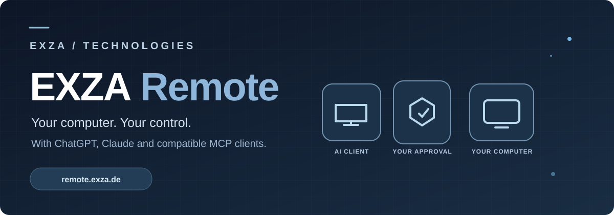
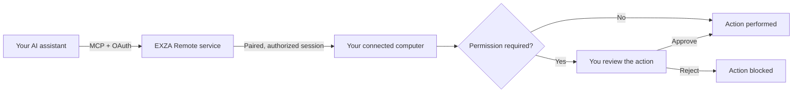

<div align="center">




# EXZA Remote

### AI Computer Commander

Your computer. Your control. With ChatGPT and Claude.

**EXZA Remote — AI Computer Commander.**

**An MCP server for AI-powered remote computer access: connect ChatGPT, Claude, and other compatible AI assistants to your own Mac, Windows, or Linux computer with secure device pairing and owner-controlled permissions.**

**Official installation and licensing notice:** EXZA Remote is a **proprietary, hosted MCP service**, not an open-source or npm-distributed MCP package. **Do not use** the third-party command `claude mcp add exza-remote -- npx exza-remote`: it is **not an official EXZA installation command**. Instead, sign up at [remote.exza.de](https://remote.exza.de/app/?register=1), install the verified computer client using the [official instructions](docs/GETTING_STARTED.md), and add the HTTPS MCP endpoint `https://remote.exza.de/mcp` in your supported AI client using EXZA OAuth. Do not enter a device PIN as an API token. Report suspected security issues according to [SECURITY.md](SECURITY.md). See [NOTICE.md](NOTICE.md) for the proprietary licensing scope.

[**Visit Website**](https://remote.exza.de/) · [**Get Started**](https://remote.exza.de/app/) · [**Installation Commands**](#install-exza-remote--terminal-commands) · [**Documentation**](https://remote.exza.de/help) · [**Explore Prompt Library**](https://remote.exza.de/prompts/)

### Use EXZA Remote directly in ChatGPT on the web — not only in Codex

**No Codex installation is required for supported ChatGPT web conversations.** Connect the EXZA Remote MCP server in ChatGPT's Plugins interface (where your account or workspace allows custom MCP connections), pair your own computer, and ask ChatGPT to inspect permitted files, check a process, or run an owner-approved terminal command **right in the conversation**. ChatGPT Work and Codex are other supported ways to work with MCP tools where available; Claude can use a compatible custom MCP connection too.

**Connect:** [Create your EXZA account](https://remote.exza.de/app/?register=1) → pair your Mac, Windows, or Linux computer → in supported **ChatGPT Web → Plugins → Add custom MCP server**, use **`https://remote.exza.de/mcp`** and sign in through EXZA OAuth → select EXZA Remote in your chat. [Step-by-step ChatGPT & Claude setup](docs/AI_MCP_GUIDE.md).

*ChatGPT availability, full computer/write actions and plugin creation depend on plan, workspace permissions and OpenAI's supported surfaces. Public directory listing is separate from a manually connected MCP server. EXZA Remote is independent of OpenAI and Anthropic.*

[Deutsch](README.de.md) · [Security](SECURITY.md) · [Support](https://remote.exza.de/help)

</div>

---

## AI remote computer access with MCP — without giving up control

EXZA Remote helps developers, creators, and technical teams connect **ChatGPT or Claude to their own computer** through the **Model Context Protocol (MCP)**. It is a remotely accessible MCP service with a local computer client, not a cloud-hosted virtual desktop or a generic code repository.

**Why use it?** You can ask an authorized AI assistant to inspect supported files, check a system, follow a terminal job, or handle compatible desktop tasks — while keeping permissions, device pairing, and sensitive-action approvals under your control. Available capabilities depend on your operating system, AI client, and authorized scope.

| For | Example benefit |
| --- | --- |
| **Software developers** | Review permitted project files and run an approved local test without pasting every terminal result into chat. |
| **IT and technical support** | Inspect device status and allowed diagnostic output from a paired computer. |
| **3D creators and makers** | Use supported desktop and terminal workflows for authorized local scripts and applications. |
| **Everyday productivity** | Coordinate approved file and application tasks through your AI assistant. |

**Try EXZA Remote:** [Create an account and pair a device](https://remote.exza.de/app/) · [Read the installation guide](docs/GETTING_STARTED.md) · [See the supported platforms](docs/PLATFORMS.md)

## AI can help. You stay in control.

EXZA Remote connects your computer to **ChatGPT, Claude, and other compatible MCP clients** through an authenticated remote connection. Instead of manually moving files or copying terminal output into a chat, you can use supported tools to work with your *own* computer — subject to your account permissions, device capabilities, and required approvals.

The system is built around a straightforward principle: **AI access should be explicit, visible, and revocable.**

## What you can do

| Capability | What it enables |
| --- | --- |
| **AI assistant connectivity** | Connect ChatGPT, Claude, or compatible Model Context Protocol (MCP) clients via a single HTTPS MCP endpoint. |
| **Computer pairing** | Link a computer to your EXZA account with a one-time code and confirmation in the local terminal. |
| **File operations** | Discover, inspect, and manage allowed files within approved device scope. Changes require appropriate authorization. |
| **Terminal & jobs** | Run supported commands and follow authorized long-running tasks on your connected computer. |
| **System & process information** | Check device status, system details, and supported processes. |
| **Desktop interactions** | Perform supported application/window actions where the operating system and permissions allow it; some functions are macOS-specific. |
| **Approval controls** | Review or deny sensitive requests through local and platform authorization mechanisms. |
| **Account dashboard** | See paired devices, manage connections, review usage, and access account or billing settings. |
| **Multi-platform client** | Client setup paths for macOS, Windows, and Linux; available tools and tested behavior vary by platform. |

**Tools and permissions:** EXZA Remote registers 59 MCP tool interfaces in its current integration. This does **not** mean every interface works on every OS, or that every action runs without approval. See the [59-tool catalog](docs/TOOLS.md), [Features & tool categories](docs/FEATURES.md), and [Platform compatibility](docs/PLATFORMS.md).

## How it works



The local computer remains yours. Connections and actions depend on your session status and the permissions you grant. Closing the local client ends its active computer connection.

## Getting started

1. Open [**remote.exza.de**](https://remote.exza.de/) and create an EXZA account.
2. Sign in to the [**customer dashboard**](https://remote.exza.de/app/) and open **My Devices**.
3. Choose the official installation instructions for **macOS, Windows, or Linux**.
4. Start the local EXZA Remote client on your computer. Enter the displayed one-time pairing code in the dashboard and confirm the request in the terminal.
5. In a supported AI client, add the remote MCP server using **`https://remote.exza.de/mcp`**, then complete the EXZA sign-in and permission flow.
6. Begin with a harmless action such as checking device connection status.

**Follow the current platform-specific steps in the [official documentation](https://remote.exza.de/help).** Never paste passwords, device secrets, or access tokens into an AI conversation.

## Install EXZA Remote — terminal commands

You **do not need to clone this GitHub repository**. It is a public product presentation, not a source-code download. Install the client from the official [EXZA Remote website](https://remote.exza.de/) on a computer you own or are authorized to use.

**Requirements:** [Node.js 22+](https://nodejs.org/) including npm, internet access, and an EXZA account. macOS/Linux also require curl, unzip and a SHA-256 utility. **Administrator/root access is not needed.**

### If Node.js is missing or outdated

EXZA Remote needs **Node.js 22 or newer**, including **npm**. You can install it **free of charge** from the official [Node.js download page](https://nodejs.org/en/download). Choose a maintained **LTS** release compatible with your operating system. You do **not** need to download Node.js from GitHub or share your EXZA login details.

**Check the versions first** (macOS/Linux Terminal or Windows PowerShell):

```sh
node --version
npm --version
```

- **macOS:** Open [nodejs.org/en/download](https://nodejs.org/en/download), choose the macOS installer for your supported system, download the official `.pkg`, run the installer and follow its prompts. Close and reopen Terminal afterwards.
- **Windows 10/11:** On the same official page choose the Windows installer (`.msi`) for your architecture, run it and keep the default npm installation enabled. Close and reopen PowerShell after installing. Administrator approval might be requested by the Node.js installer, but EXZA Remote itself should run as your normal user.
- **Linux:** Follow the Linux instructions on the [official Node.js download page](https://nodejs.org/en/download). If the `nvm` version manager is **already installed**, you can run the following to install a maintained LTS release for your user account. If `nvm` is not installed, follow the official installation instructions for your distribution and a trusted version manager first; **do not copy an unknown `curl | bash` command**.

```sh
nvm install --lts
nvm use --lts
```

**Verify again** after reopening your terminal:

```sh
node --version
npm --version
```

If the commands still say `command not found`, `not recognized`, or the version begins with `v20` or lower, verify that Node.js is installed and on your shell's `PATH`, then reopen the terminal. If Node.js already reports `v22` or newer and npm reports a version, **skip this installation step** and continue with the EXZA Remote command below.

**Do not overwrite or restart a running EXZA Remote connection just to install Node.js.** Finish the current session safely before changing runtimes.

### macOS — Terminal

Open Terminal and verify that Node.js and npm are installed:

```sh
node --version
npm --version
```

Then run the **same official command shown in the EXZA customer portal**:

```sh
curl -fsSL https://remote.exza.de/install.sh -o exza-install.sh && sh exza-install.sh
```

### Windows 10/11 — PowerShell

Open PowerShell as a **normal user**, check the prerequisites, download the official script and run it:

```powershell
node --version
npm --version
curl.exe -fsSL https://remote.exza.de/install.ps1 -o exza-install.ps1
powershell -NoProfile -ExecutionPolicy Bypass -File .\exza-install.ps1
```

The `-ExecutionPolicy Bypass` option applies only to that PowerShell process, not to the permanent system policy. **Inspect the script first** and only run it when downloaded from `remote.exza.de`; follow your organization's security rules. Windows native end-to-end testing is currently more limited than macOS.

### Linux — Terminal

Install Node.js 22+ and npm, verify them, and run the official Unix installer:

```sh
node --version
npm --version
curl -fsSL https://remote.exza.de/install.sh -o exza-install.sh && sh exza-install.sh
```

Linux distribution and desktop-tool compatibility may vary. See [Platforms](docs/PLATFORMS.md).

**How installation works:** The scripts download the official client ZIP over HTTPS, verify its SHA-256 checksum, install runtime dependencies and start the client in a **visible foreground terminal**. Keep that terminal open while using EXZA Remote. Review the public [macOS/Linux installer](https://remote.exza.de/install.sh) or [Windows installer](https://remote.exza.de/install.ps1) before running it.

### Pair your device and connect an AI assistant

1. Register or sign in to [EXZA Remote — My Devices](https://remote.exza.de/app/) and verify your email if requested.
2. Wait for the **server-confirmed six-digit PIN** in your running terminal. Enter it on the website within five minutes.
3. Check the requesting account and **press Y in the terminal to approve** or **N to deny** the pairing.
4. In a compatible ChatGPT, Claude or other AI client, add a custom remote MCP connection:
   - **Name:** EXZA Remote
   - **Server URL:** `https://remote.exza.de/mcp`
   - **Sign-in:** EXZA OAuth account; review device selection and requested permissions.
5. Try a read-only prompt: *“Check whether my EXZA Remote computer is online. Do not change anything.”*

Custom MCP connector availability depends on the AI service, plan and account/workspace settings.

### Useful commands and troubleshooting

| Command inside the **running EXZA terminal** | Meaning |
| --- | --- |
| `status` | Inspect the current connection and pairing state. |
| `new code` | Request a fresh PIN when not yet paired and the previous code has expired. |
| `reset pairing` then `confirm reset pairing` | If the former local pairing has been revoked or is unusable, confirm the local reset within 30 seconds. A new pairing still requires Y approval. |

**Do not start a second agent** while the first terminal is connected. Removing a device in the website and resetting its local pairing are different actions. Closing the terminal ends its active connection. Never share PINs, passwords, tokens or private logs in public discussions.

[Full getting-started guide](docs/GETTING_STARTED.md) · [ChatGPT/Claude setup](docs/AI_MCP_GUIDE.md) · [Help Center](https://remote.exza.de/help)

## Built for real workflows

- **Development:** inspect project files, check tooling, and run an approved test command.
- **Diagnostics:** review permitted logs, check running processes, and collect environment information.
- **File organization:** inspect a selected folder before approving a safe change.
- **Creative workflows:** launch supported tools or run explicitly approved local scripts where available.
- **Everyday productivity:** coordinate supported desktop tasks without sharing unrestricted access.

[See example workflows →](docs/USE_CASES.md)

## Plans

EXZA Remote offers a **free tier with 10,000 successful tool calls per EXZA account per UTC month**, shared across connected AI clients. Premium options and applicable pricing are displayed on the [official website](https://remote.exza.de/) and in the dashboard. Availability, features, and fair-use terms are governed by the current product offering.

## Security by design

- Account sign-in and device-specific pairing.
- OAuth-based AI client authorization.
- Local confirmation of pairing requests.
- Permission checks and additional approval for sensitive actions.
- Device access controls and disconnection through the customer portal.
- HTTPS for the public MCP endpoint.

**No remote-control software can eliminate all risk.** Review requests before approving commands, file changes, or other sensitive operations. Read [Security & responsible disclosure](SECURITY.md) and the [security model](docs/SECURITY_MODEL.md).

## Documentation

| Guide | Contents |
| --- | --- |
| [Connect ChatGPT or Claude via MCP](docs/AI_MCP_GUIDE.md) | Practical AI remote-computer setup and safe first workflows |
| [Getting started](docs/GETTING_STARTED.md) | First connection and onboarding |
| [Features](docs/FEATURES.md) | What EXZA Remote can do |
| [Tool catalog](docs/TOOLS.md) | All 59 registered MCP tool interfaces |
| [Platforms](docs/PLATFORMS.md) | OS-specific support and caveats |
| [Example workflows](docs/USE_CASES.md) | Safe, practical scenarios |
| [Security model](docs/SECURITY_MODEL.md) | Access, approvals, and responsibilities |
| [FAQ](docs/FAQ.md) | Common questions and troubleshooting |
| [Press & product information](docs/PRESS_KIT.md) | Short description and launch assets |
| [Product announcement](docs/ANNOUNCEMENT.md) | Public introduction and useful feedback channels |
| [Deutsche Übersicht](README.de.md) | Produktbeschreibung auf Deutsch |

**Support:** [Official Help Center](https://remote.exza.de/help) · [German Help Center](https://remote.exza.de/hilfe) · [Contact](mailto:info@exza.de)

---

<div align="center">

**EXZA Remote** · Developed by **EXZA – Technologies**

[Website](https://remote.exza.de/) · [Customer Portal](https://remote.exza.de/app/) · [Privacy](https://remote.exza.de/legal/datenschutz.html) · [Terms](https://remote.exza.de/legal/nutzungsbedingungen.html)

*This is the official public product-information repository, not an open-source release of the private EXZA Remote application. All rights reserved. See [NOTICE](NOTICE.md).*

</div>